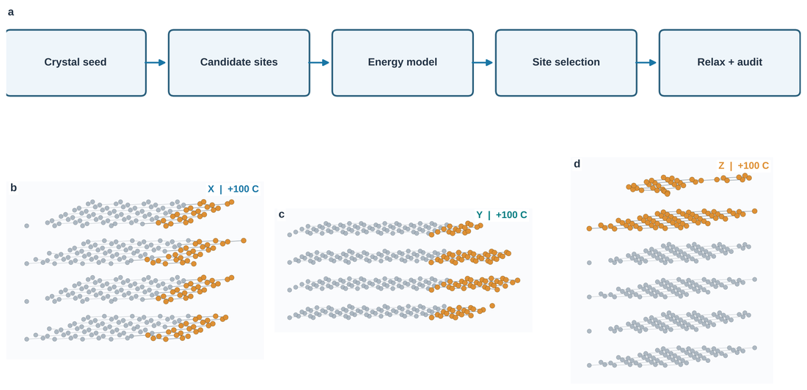
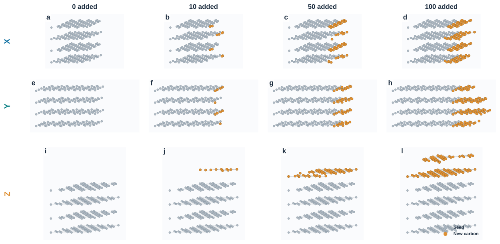

# GROWN

**Growth through Reproducible, Orientation-aware Workflows for Nanostructures**

**A scientific Python framework for template-guided, direction-resolved atomistic crystal growth.**


> **Research release — Input Builder v0.1.** This source repository supports
> `pip` installation and a Conda environment, but the software is **not yet
> published to PyPI or Anaconda**. This repository has no GitHub Actions jobs
> and runs no ML/DFT simulations automatically.

<p align="center">

</p>

GROWN constructs successive atomistic configurations at crystallographic
growth fronts by combining a **CIF structure**, an optional crystal/film
template, candidate-site screening, a selected energy calculator and local
relaxation. The **Input Builder** separates scientific setup from the
multi-flag research engine, enabling reproducible inputs without editing
Python source.

## Highlights

- Single-axis **X/Y/Z** growth, plus **XY/XZ/YZ** simultaneous fronts where
  compatible with the structure; multi-axis work can be computationally costly.
- Material-aware geometry and boundary-condition validation for **2D, 3D,
  layered slabs and bulk-like layered crystals**.
- Selective crystal-front templates, defect/vacancy probabilities,
  substitutional dopants and supported graphene geometries.
- Energy/force calculator interfaces including **MACE**, **CHGNet** and
  **GPAW**; optional third-party backends must be installed separately.
- `grown-input init`, `validate`, `generate` and `status` with auditable
  configurations, geometrical adviser reports and PBS/local job scripts.
- Curated **original CIFs, input configurations and archived command files**
  from the manuscript. Heavy scientific trajectories are not in GitHub.

## Installation

**With pip:**

```bash
git clone https://github.com/tromer-unb/GROWN.git
cd GROWN
python3 -m venv .venv
source .venv/bin/activate
python -m pip install -e .
grown-input --help
```

**With Conda / Miniforge:**

```bash
git clone https://github.com/tromer-unb/GROWN.git
cd GROWN
conda env create -f environment.yml
conda activate grown
python -m pip install -e . --no-deps
grown-input --help
```

These commands install **only the lightweight input-preparation
dependencies** (ASE, NumPy and SciPy). Installing an energy model is separate;
see [Installation](docs/INSTALLATION.md) and [Backends](docs/BACKENDS.md).

## Input Builder in practice

Use a real, archived **graphene-X** seed and its paired JSON specification:

```bash
grown-input validate software/GROWN_INPUT_BUILDER/examples/graphene_X.json
grown-input generate software/GROWN_INPUT_BUILDER/examples/graphene_X.json
grown-input status software/GROWN_INPUT_BUILDER/examples/generated/graphene_X
```

**No growth or model inference is performed by these commands.** The
generated directory contains `run.sh`, `job.pbs`, copied structures, source
engine, `input_config.json`, `validated_input.json`, `advisor_report.txt`
and geometric preflight records. The user must inspect them and explicitly
decide whether to submit a calculation on suitable computing hardware.

To prepare a new system, use the interactive wizard:

```bash
grown-input init my_new_case.json
```

See the complete [Input Builder tutorial](docs/INPUT_BUILDER.md) and
[configuration reference](docs/CONFIG_REFERENCE.md).

## Original study examples

<p align="center">

</p>

| System | Curated scientific inputs |
|---|---|
| Graphite AB, independent X/Y/Z | [Actual 100-event MACE configurations and 256-atom seeds](examples/paper/graphite_ab/) |
| Graphene and Si(100) | [Builder demonstrations](software/GROWN_INPUT_BUILDER/examples/) |
| 2H MoS₂ | [Monolayer input](software/GROWN_INPUT_BUILDER/examples/MoS2_X.json) |
| Graphite XZ with B substitution | [Original builder example](software/GROWN_INPUT_BUILDER/examples/graphite_XZ_B.json) and [archived commands](examples/paper/graphite_boron/) |
| Graphene on MoS₂ / SiC | [Actual source geometries and model commands](examples/paper/) |
| 10%/20% vacancies; 10% N | [Original defect run inputs](examples/paper/graphene_defects/) |
| Historical material scope | [72-case source matrix](examples/paper/historical_72_case_matrix.csv) |

See [the complete case-by-case guide](docs/PAPER_EXAMPLES.md) for model
assumptions, event counts, original versus portable configurations, and
important incompleteness/termination distinctions.

## Scientific scope and limitations

GROWN uses whichever **energy calculator** is selected; it does not supply
an independently calibrated interlayer energy, chemical kinetic rate
constant or experimental growth velocity. The configured event target is
an **upper limit on accepted deposition events**, *not* the number of
candidate sites tested. A normal stop with no eligible candidate does not
prove thermodynamic growth arrest.

In the Bernal graphite example, the MACE-driven Z trajectory retained an
interlayer separation near **3.360 Å**. A simple fixed-geometry MACE
cleavage calculation gave **0.271 J m⁻²** versus the experimentally
constrained ideal-AB reference of **0.39 ± 0.02 J m⁻²**, an encouraging
qualitative agreement in sign and scale but a **30.5% underestimate**.
The AB stacking was imposed by the template, not formed spontaneously.
CHGNet gave a nonphysical interlayer result in this specific test.
Interpretation must be **calculator-dependent and trend-based**, not a
prediction of laboratory growth rates.

In a graphite XZ demonstration 100 events required **33,114 energy-scored
candidates**, versus 1,173 for X alone; two-direction growth is therefore
best reserved for smaller cells and targeted studies in the current
implementation. See [Scientific method](docs/SCIENTIFIC_METHOD.md).

## Documentation

| Need | Guide |
|---|---|
| pip, Conda, model setup | [Installation](docs/INSTALLATION.md) |
| Wizard, validation, generation | [Input Builder](docs/INPUT_BUILDER.md) |
| JSON keys, PBC and templates | [Configuration](docs/CONFIG_REFERENCE.md) |
| MACE/CHGNet/GPAW | [Backends](docs/BACKENDS.md) |
| Source examples from paper | [Paper examples](docs/PAPER_EXAMPLES.md) |
| Algorithmic stopping and limits | [Scientific method](docs/SCIENTIFIC_METHOD.md) |
| Full-data reproducibility | [Reproducibility](docs/REPRODUCIBILITY.md) |
| Errors and PBS debugging | [Troubleshooting](docs/TROUBLESHOOTING.md) |
| Portuguese summary | [Guia rápido PT-BR](docs/GUIA_RAPIDO_PT_BR.md) |
| Contributions | [CONTRIBUTING](CONTRIBUTING.md) |

## Citation and licensing

This is a **research software repository, not yet a peer-reviewed
software release**. The manuscript is being prepared for *npj
Computational Materials*; no DOI is claimed. See [CITATION.cff](CITATION.cff).
Repository software is licensed under [MIT](LICENSE); third-party
potential models/checkpoints have their own license terms. Full raw
trajectories, HPC logs and large datasets must be deposited separately
for complete public numerical reproduction.
